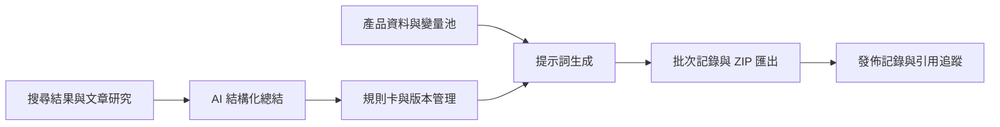

# Data Aurora GEO 生成式引擎優化平台

此倉庫整理 GEO 平台的前後端源碼，展示從搜尋結果研究、AI 結構化總結、規則卡管理，到提示詞生成、版本及批次管理的實作。它保留目前項目的功能程式，並排除生產設定、客戶資料和媒體檔案。

## 核心工作流程



## 技術與業務模組

| 範圍 | 技術及實作 |
| --- | --- |
| 前端 | Vue 3、TypeScript、Vite、Pinia、Vue Router、Element Plus、ECharts |
| 後端 | NestJS 11、TypeScript、REST API 與流式回應 |
| 資料層 | Prisma 6、MySQL；產品、規則、版本、生成任務及發佈記錄模型 |
| AI 整合 | Anthropic SDK／Claude 相容配置、AI 總結及提示詞生成 |
| 研究工具 | SERP 解析、文章內容處理、Python 抓取輔助程式 |
| 擴展模組 | 影片生成、素材庫、片段分析及組裝工作台 |

核心 GEO 功能包括：

- 搜尋研究與文章分析，記錄搜尋結果及文章結構。
- AI 總結、規則卡生成及啟用。
- 產品資料、提示詞版本、固定規則及變量池管理。
- 單條／批量提示詞生成、任務狀態、歷史快照及 ZIP 下載。
- 發佈記錄、回饋及搜尋引用追蹤。

功能存在於源碼，不代表第三方搜尋、模型或媒體服務已在本次展示中接通。當前快照亦包含後續擴展模組，不能僅由此次上傳日期推定各功能的原始開發時間。

## 目錄與啟動

```text
frontend/   完整前端 src、構建配置及環境範例
backend/    後端 src、Prisma schema、遷移及環境範例
docs/       技術證據索引及副本整理說明
```

先依 [後端說明](backend/README.md) 配置獨立的本地 MySQL 和管理員帳戶，再依 [前端說明](frontend/README.md) 啟動介面。預設前端地址為 `http://localhost:19986`，後端 API 為 `http://localhost:19988/api`。

本次沒有部署公網演示服務，也沒有連接原資料庫或執行付費模型呼叫。原認證及接口存取控制仍有局限，應依後端 README 在本地隔離環境檢視，不作為完成生產安全加固的版本。

## 源碼閱讀

[技術證據索引](docs/technical-evidence.md) 將前端頁面、API、AI 邏輯及資料模型逐項連結，便於核對技術實作。完整整理及驗證範圍見 [副本說明](docs/snapshot-notes.md)。

源碼可作為技術經歷的補充材料；歷史開發時間、任職及個人職責仍需結合其他可核實資料。此次提交為當前源碼整理快照，沒有重建或回填歷史 Git 記錄。
